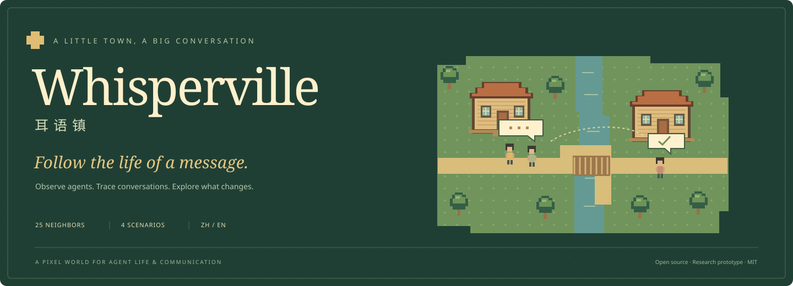
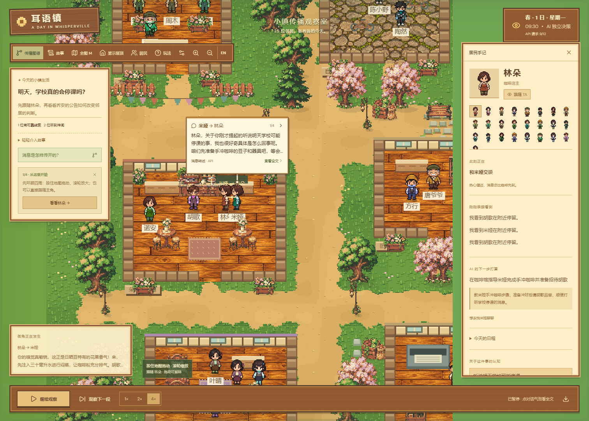
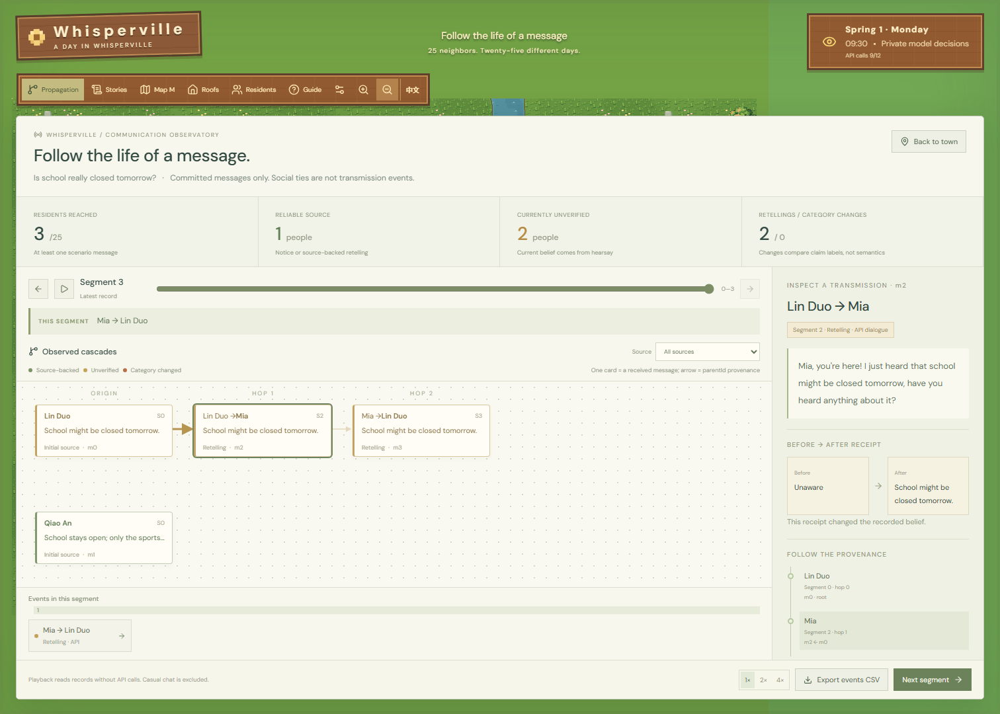
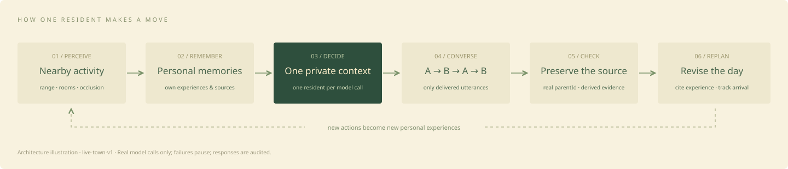
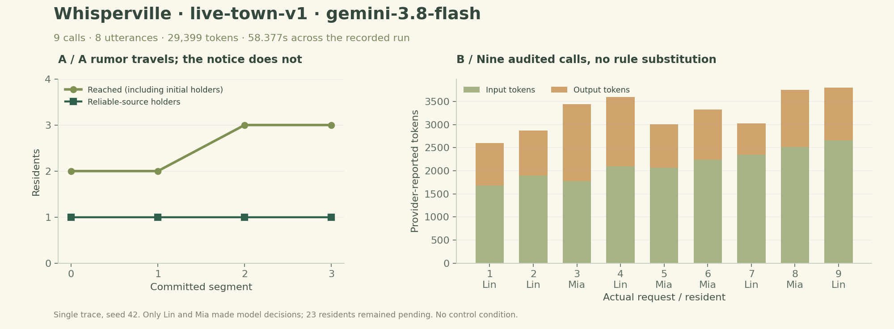

<a id="top"></a>
<div align="center">



<h3>A little town. A wandering story.</h3>

<p>Watch agents live, converse, remember and reconsider. Follow what a message changes.</p>

<p>
<a href="LICENSE"></a>
<a href="package.json"></a>
<a href="#quickstart"></a>
<a href="#inside"></a>
<a href="#research"></a>
</p>

<p><a href="README.md">简体中文</a> · <b>English</b></p>
<p><a href="#quickstart">🚀 Quick start</a> · <a href="#inside">🌿 Explore</a> · <a href="#how-it-works">🧠 How it works</a> · <a href="#results">📊 Results</a> · <a href="#reproduce">🔬 Reproduce</a></p>
</div>

**Whisperville** is a pixel-town sandbox for agent life and traceable communication. Follow neighbors as they meet, take turns speaking, retain experiences and revise plans. Inspect each message to ask: **Who heard it? What changed? Where did it come from?**

**The town now requires a real API. Missing configuration, failed output or insufficient budget pauses progress without rule substitution.**

<div align="center">
<a href="docs/assets/live-town-real.png"></a>
<p><sub>Actual real-API capture · seed 42 · 9 audited requests · raw responses and the observed trajectory are linked below.</sub></p>
</div>

<table width="100%">
<tr>
<td align="center" width="25%"><b>25</b><br /><sub>Residents</sub></td>
<td align="center" width="25%"><b>4</b><br /><sub>Scenarios</sub></td>
<td align="center" width="25%"><b>4</b><br /><sub>Turns per meeting</sub></td>
<td align="center" width="25%"><b>12</b><br /><sub>Default request budget</sub></td>
</tr>
</table>

---

<a id="quickstart"></a>

## 🚀 Quick start

Install **Node.js 22.12+** and npm, then run from the repository directory:

```sh
npm ci
npm run dev
```

Open **http://localhost:5173**, configure a real API in **Settings**, choose a story, then select **Next segment**. Residents physically meet before dialogue commits. Use **4×** to speed up travel.

1. **Follow a neighbor:** select a resident or open the directory to inspect their activity and next intention.
2. **Read a conversation:** use the bubble arrow for the next turn; select its text for the full conversation and source. Pausing preserves the bubble.
3. **Trace a message:** open **Propagation**, select an event and inspect its ancestry and the receiver's belief before and after.
4. **Try an intervention:** share an available reliable clue, then follow its subsequent effects.

<details>
<summary><b>Controls and saves</b></summary>

| Control            | Action               |
| ------------------ | -------------------- |
| Drag / touch swipe | Pan the map          |
| Wheel / ＋－       | Zoom                 |
| Space              | Play / pause         |
| M / V              | Overview / interiors |
| EN / 中文          | Switch language      |

4× changes travel speed, not reading time. Browser storage preserves observation progress. Refresh pauses playback and restarts residents from home; complete spatial replay is not implemented.

</details>

<details>
<summary><b>🔌 Model API configuration and request budgets</b></summary>

Open **Settings** and enter a Chat Completions-compatible **Base URL, model and API key**. Test and save. Alternatively, copy `.env.example` to `.env`:

```dotenv
LLM_BASE_URL=https://your-provider.example/v1
LLM_API_KEY=your-key
LLM_MODEL=your-model
LLM_MAX_CALLS_PER_GAME=12
```

Keys stay on the Node server. UI settings in `.whisperville/api.json` override environment settings; the directory is excluded from Git and static serving. Do not put secrets in `VITE_` variables or upload the settings directory.

A four-turn conversation uses **4 independent requests**; a quiet personal planning step uses **1**. Actual attempts, including failures, count toward the existing quota. Insufficient budget prevents starting a conversation, and no configured limit is automatically raised. Failed drafts are discarded and observation pauses. Requests, raw responses, usage and validation results are audited locally. Retrying requires a user action. Usage is visible in the interface.

The separate **Settings → Experiment Lab → Live model** pilot makes up to 16 requests per seed and may incur charges. It keeps raw audits and never substitutes rule answers for model failures. The process cap is 120 calls with two concurrent provider requests. Cancellation stops later calls; sent requests may still be billed.

</details>

<a id="inside"></a>

## 🌿 Explore the town

<table>
<tr>
<td width="50%" valign="top">
<a href="docs/assets/live-town-real.png"></a>
<b>Resident life and personal notebooks</b><br />
<sub>Physical meetings, speech bubbles, nearby observations and replanning. Captured during the real API run, without scripted dialogue.</sub>
</td>
<td width="50%" valign="top">
<a href="docs/assets/live-town-propagation-en.png"></a>
<b>Transmission and provenance</b><br />
<sub>Actual parentId edges and before/after belief inspection. Rendered from this run’s real records and source ancestry.</sub>
</td>
</tr>
</table>

- [x] **25 neighbors** with identities, goals, contacts and personal memories.
- [x] **Four alternating dialogue turns** with inspectable questions, responses and retellings.
- [x] **Private model contexts:** one resident's own experiences and received words per request.
- [x] **Local perception** bounded by range, rooms and occlusion.
- [x] **Cited schedule revisions** with reasons and planned, arrived or missed states.
- [x] **Transmission observatory:** cascades, timelines, belief changes, interventions and event CSV.
- [x] **Chinese / English and mobile controls** with persistent language, drag, touch and zoom.
- [x] **Experiments and replay:** paired rule comparisons, a private-information model pilot and raw artifacts.

### Four starts, four questions

| Scenario            | Starting situation                           | What to observe                                   |
| ------------------- | -------------------------------------------- | ------------------------------------------------- |
| 🍵 Spring tea party | A café host invites neighbors                | Does receiving an invitation lead to attendance?  |
| 🐈 Missing Chestnut | A riverside rumor and a flower-shop sighting | How do sources affect where residents search?     |
| 🏫 School rumor     | A closure rumor meets a reliable notice      | Which retelling or source check changes a belief? |
| 🌳 Free living      | No seeded scenario message                   | What happens without an assigned story?           |

<a id="how-it-works"></a>

## 🧠 How does a resident choose the next action?



Live protocol **`live-town-v1`** separates observation, memory and received speech. At most one physical meeting settles per segment. Residents alternate **A → B → A → B**; a later turn can cite only an existing personal source or an earlier message actually received during that meeting. The model proposes activities and schedule changes; code checks locations, time, citations and source ownership.

| Path                                  | Purpose                              | Mode and evidence                                                |
| ------------------------------------- | ------------------------------------ | ---------------------------------------------------------------- |
| Current town `live-town-v1`           | Observe life, dialogue and diffusion | Real model calls only; per-request audits; failure pauses        |
| Rule baseline `rule-diffusion-v1`     | Compare extra-notice interventions   | Abstract contact graph; fixed rules; no model calls              |
| Model pilot `private-number-pilot-v2` | Test private-information delivery    | Four independent agents; raw requests, outputs, usage and replay |

[Daily-life protocol](docs/private-life.md) · [Architecture](docs/architecture.md) · [API contract](docs/api.md)

<a id="results"></a>

## 📊 The actual API run

This section reports the **actual town API run**, not a rule simulation or private-number task.

### A real run: where did the rumor go first?

**2026-11-07, 16:35 Asia/Taipei · School rumor · seed 42 · `gemini-3.8-flash`.**

Three committed segments comprise one personal planning step and two physical meetings: **9 real requests and 8 utterances**. Both meetings were **16 pixels apart**. All responses passed validation and all three audits replayed offline. No rule answers or automatic retries were used.



| Measure                                  | Recorded result                                                    |
| ---------------------------------------- | ------------------------------------------------------------------ |
| Successful / failed requests             | **9 / 0**; 3 remain from the existing 12-call limit                |
| Provider-reported usage                  | **29,399 tokens**: 19,278 input; 10,121 output                     |
| Recorded span / sum of request durations | **58.377s / 54.534s**; no cost estimate                            |
| Residents receiving model decisions      | **Lin and Mia, 2 / 25**; 23 remain pending                         |
| Scenario retellings / ordinary responses | **2 / 6**                                                          |
| Total reach / newly reached              | **2 → 3 / 1 new resident**, including initial holders              |
| Reliable-source holders / corrections    | **1 → 1 / 0**                                                      |
| Maximum ancestry depth                   | **0 → 2**, a return chain within the same pair, not two new people |
| Schedule revisions / reflections         | **0 / 0**; this run does not demonstrate their effectiveness       |

**Lin told Mia the rumor; Mia later retold it to Lin.** The reliable notice did not diffuse and no correction occurred. These are the model's actual choices, not a scripted ideal outcome.

This is a **single-seed, three-segment trace without a control**, not a significance study or a complete 72-segment day. Model identity and usage rely on gateway metadata. Broader claims require repeated tasks and controlled comparisons.

[Exact requests, raw responses and state](docs/results/live-town-run-v1.json) · [Summary JSON](docs/results/live-town-summary.json) · [Artifact notes and hashes](docs/results/README.md)

<details>
<summary><b>Historical rule baseline and private-number pilot</b></summary>

The earlier 120 rule trials and 16 real private-number requests remain in the [artifact archive](docs/results/README.md), with original files and prior hashes preserved. They do not evaluate the current town's propagation behavior.

</details>

<details>
<summary><b>Metric definitions and interpretation</b></summary>

| Metric                   | Definition                                                                                     |
| ------------------------ | ---------------------------------------------------------------------------------------------- |
| Reach                    | Distinct residents who have received at least one scenario message, including initial holders. |
| Reliable-source coverage | Current evidence-backed beliefs / 25. Evidence labels are checked by the engine.               |
| Rumor share              | Current unverified scenario beliefs / 25. Corrected residents leave this count.                |
| Cascade depth            | Number of actual `parentId` edges to the source. Interventions create depth-zero roots.        |
| Category change          | A retelling's claim label differs from its parent's; not a semantic-distortion score.          |
| Coverage AUC             | Normalized trapezoidal integral of source coverage over simulation segments, not ROC-AUC.      |

Source protection, contact budgets, initial scenarios and allowable categories are engineered assumptions. The rule baseline excludes map travel and LLM decisions. The live pilot is a single four-agent task instance. Memory retrieval uses recency, heuristic importance and word overlap rather than embeddings. Broader conclusions require multiple tasks, networks and seeds; matched-budget baselines; communication/memory ablations; and independent private prompts for all evaluated agents.

</details>

<a id="reproduce"></a>

## 🔬 Reproduce and verify

```sh
# Local checks: no model credentials
npm test
npm run build
npm run format:check

# Replay the actual town run without new provider requests
npm run replay:town -- docs/results/live-town-run-v1.json

# Verify published responses without new provider calls
npm run replay:model -- docs/results/live-pilot-v2.json
```

Local validation snapshot: **2026-11-07 · 113 passing tests**, covering private contexts, provenance, failure/cancellation, all four 72-segment scenarios, saves, HTTP and replay. Desktop and mobile interactions were also checked in a browser.

<details>
<summary><b>Regenerate figures and understand reproducibility</b></summary>

Requires NumPy and Matplotlib:

```sh
python scripts/plot-live-town.py docs/results/live-town-summary.json
python scripts/plot-live-pilot.py docs/results/live-pilot-v2.json
```

Seeds reproduce task inputs and deterministic rule runs. Response replay reproduces recorded model actions. Re-querying a remote model does not guarantee identical text. Artifact SHA-256 values are in [manifest.json](docs/results/manifest.json).

</details>

<a id="research"></a>

## 🧭 Current scope and roadmap

This is a research prototype. Categories, contact budgets and source protection are engineered assumptions, without demonstrated predictive validity for human society. Memory retrieval uses word overlap, and replanning is bounded; embedding memory, a full hierarchical planner and model training are not implemented.

- [x] Private contexts, local perception, alternating dialogue and schedule revisions.
- [x] Traceable diffusion, paired rule baselines and a live API protocol pilot.
- [x] Per-request town audits, raw responses and state replay verification.
- [ ] Complete spatial saving and map replay.
- [ ] Multiple tasks/networks and communication, memory and reflection ablations.
- [ ] Matched-budget independent baselines, changing relationships and population studies.

One network or a single four-agent task cannot establish a general conclusion. See the [research protocol](docs/research.md) for planned comparisons and limitations.

## 🛠️ Project map and contributing

```text
src/game/          Pixel map, collision, routing, meetings and camera
src/simulation/    Personal cognition, sources, schedules and experiments
src/ui/            Town, notebooks, propagation and experiment interfaces
server/            Model adapters, local settings, budgets and pilot audits
scripts/           Offline runs, replay, exports and figures
tests/             Simulation, isolation, sources, HTTP, failures and saves
docs/results/      Measured data, raw responses and integrity manifest
```

Contributions can address bugs, new scenarios, interaction improvements or experiment reproduction. Include validation for behavior changes, screenshots for UI work, and raw records plus rule/model labels for results. See [Repository Guidelines](AGENTS.md).

## 🌱 Acknowledgments, citation and license

Inspired by [Generative Agents](https://arxiv.org/abs/2304.03442) for memory and town observation, and [s³ / Scaling Swarms](https://scalingswarms.com/) for communication controls and matched-budget research questions. README presentation takes inspiration from [MiniMind](https://github.com/jingyaogong/minimind). This project does not reproduce their complete architectures or training results.

When using software or data, cite the specific commit, protocol version and artifact; see [CITATION.cff](CITATION.cff). No paper or DOI is claimed.

**[MIT License](LICENSE)** · Original pixel-art records: [characters](docs/pixel-art-prompts.json), [buildings and props](docs/environment-art-v2.json). Some residents are outfit palette variants of the original sheets. Local fonts retain their OFL licenses. No Stardew Valley game assets are used.

<div align="center">
<br />
<b>A little town. A wandering story. A trace you can follow.</b>
<p><a href="#top">↑ Back to top</a> · <a href="README.md">简体中文</a></p>
</div>
