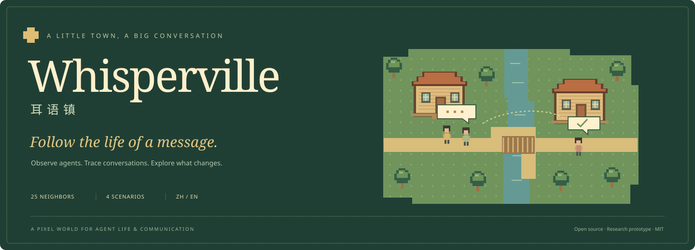
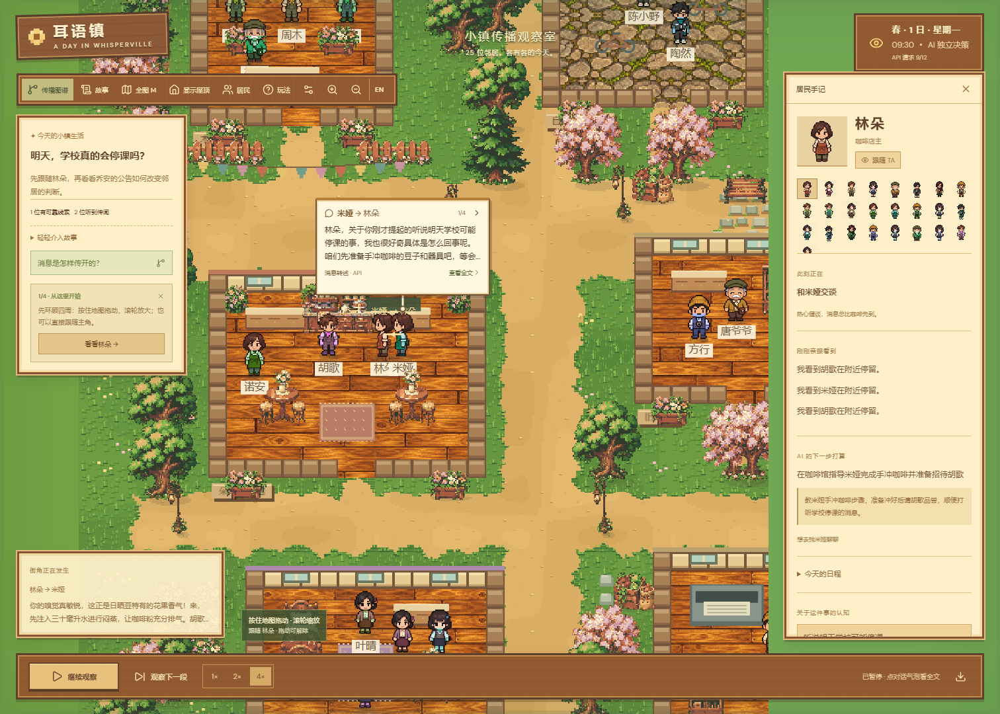
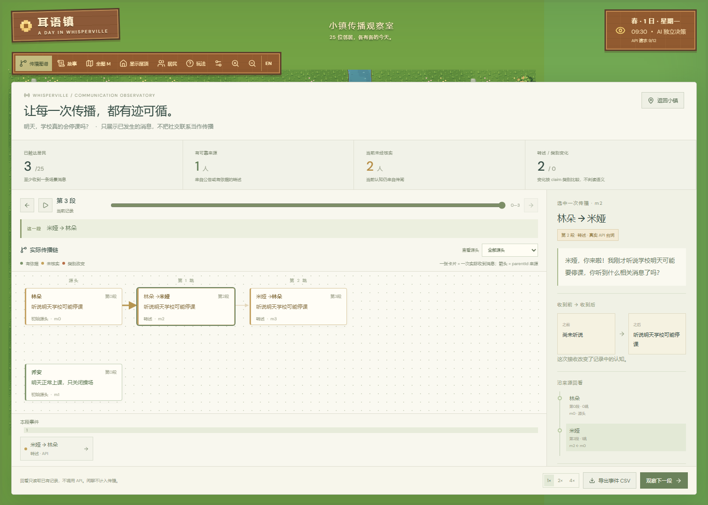
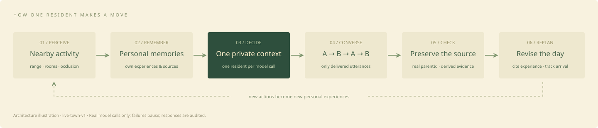
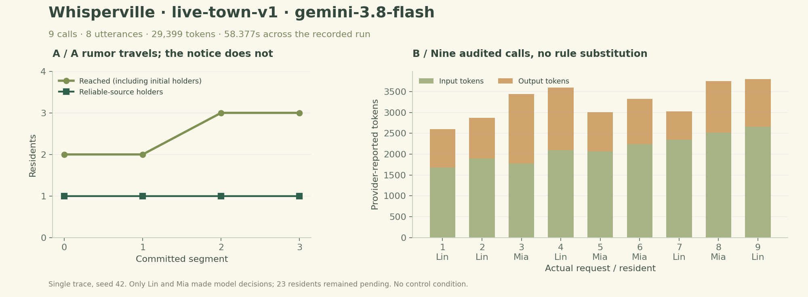

<a id="top"></a>
<div align="center">



<h3>一句耳语，如何走过整座小镇？</h3>

<p>观察 AI 居民的生活与交流，追踪消息的来源、转述和影响。</p>

<p>
<a href="LICENSE"></a>
<a href="package.json"></a>
<a href="#quickstart"></a>
<a href="#inside"></a>
<a href="#research"></a>
</p>

<p><b>简体中文</b> · <a href="README.en.md">English</a></p>
<p><a href="#quickstart">🚀 快速开始</a> · <a href="#inside">🌿 功能图览</a> · <a href="#how-it-works">🧠 工作原理</a> · <a href="#results">📊 实验结果</a> · <a href="#reproduce">🔬 复现实验</a></p>
</div>

**Whisperville（耳语镇）** 是一个像素风多智能体传播沙盒。你可以跟随居民，看他们见面、轮流说话、记住经历和调整日程；也可以沿着一条消息的来源链，检查“谁听到了、说法变了什么、认知为什么改变”。

**当前小镇只使用真实 API。未配置、失败或额度不足时暂停，不生成规则替代内容。**

<div align="center">
<a href="docs/assets/live-town-real.png"></a>
<p><sub>真实 API 实机截图 · seed 42 · 9 次已审计请求 · 原始响应与本次传播轨迹见下方数据。</sub></p>
</div>

<table width="100%">
<tr>
<td align="center" width="25%"><b>25</b><br /><sub>位居民</sub></td>
<td align="center" width="25%"><b>4</b><br /><sub>个生活场景</sub></td>
<td align="center" width="25%"><b>4</b><br /><sub>句轮流交流 / 会面</sub></td>
<td align="center" width="25%"><b>12</b><br /><sub>默认请求额度</sub></td>
</tr>
</table>

---

<a id="quickstart"></a>

## 🚀 快速开始

准备 **Node.js 22.12+** 和 npm，在项目目录运行：

```sh
npm ci
npm run dev
```

打开 **http://localhost:5173** ，先在 **设置** 中连接真实 API，再选择故事并点击 **观察下一段**。居民会先走到彼此身边，再提交交流；赶路时可切到 **4×**。

1. **跟随居民**：点居民或打开名册，看 TA 正在做什么、打算去哪里。
2. **读一场对话**：点气泡箭头切换下一句；点正文展开四句交流与来源。暂停时气泡保留。
3. **追踪传播**：打开 **传播图谱**，选择消息，查看来源链和接收前后的认知。
4. **尝试介入**：在有可靠线索的故事中分享一次消息，再观察后续变化。

<details>
<summary><b>操作速查与存档说明</b></summary>

| 操作                | 作用            |
| ------------------- | --------------- |
| 鼠标拖动 / 触摸滑动 | 移动镜头        |
| 滚轮 / ＋－         | 缩放地图        |
| 空格                | 播放 / 暂停     |
| M / V               | 全图 / 房屋透视 |
| EN / 中文           | 切换界面语言    |

4× 加快赶路，不缩短阅读时间。浏览器自动保存观察进度；刷新后暂停，居民从住处重新出发。当前尚无完整空间状态回放。

</details>

<details>
<summary><b>🔌 连接真实模型 API 与请求预算</b></summary>

在 **齿轮设置**填写兼容 Chat Completions 的 **Base URL、模型名、API Key**，测试后保存。配置即时生效，也可复制 `.env.example` 为 `.env` 后填写：

```dotenv
LLM_BASE_URL=https://your-provider.example/v1
LLM_API_KEY=your-key
LLM_MODEL=your-model
LLM_MAX_CALLS_PER_GAME=12
```

密钥只保存在 Node 服务端，不使用 `VITE_` 变量。界面配置 `.whisperville/api.json` 优先于环境变量，已从 Git 和静态文件访问中排除。不要上传该目录。

日常观察按事件发起独立请求，一场四句对话使用 **4 次**，安静时段的一次个人规划使用 **1 次**。额度按真实尝试计数，失败也计入，额度不足时不启动不完整对话。不会自动提高已配置的额度；界面显示已用请求。失败时丢弃未完成的模型对话并暂停；每次输入、原始返回、用量与校验结果都写入本机审计记录。重试由用户手动触发。**真实模型实验**仍是独立的四人私有信息审计协议，失败不会用规则补答。旧规则实验的 `rule-diffusion-v1` 与已发布结果保持独立，不代表新生活协议的效果评估。

完整真实试跑在 **设置 → 传播实验室 → 真实模型** 中手动启动。每个种子最多 16 次请求，可能产生费用；可取消后续调用。进程总上限 120 次、并发 2 次。已发请求可能仍计费。

</details>

<a id="inside"></a>

## 🌿 在小镇里，你可以看到什么？

<table>
<tr>
<td width="50%" valign="top">
<a href="docs/assets/live-town-real.png"></a>
<b>居民生活与个人手记</b><br />
<sub>实际会面、逐句气泡、附近观察、记忆与日程变更。此图来自本次真实 API 运行，不使用预写对话。</sub>
</td>
<td width="50%" valign="top">
<a href="docs/assets/live-town-propagation.png"></a>
<b>消息传播与来源追溯</b><br />
<sub>沿真实 parentId 看消息树，对比接收前后认知。此图从本次真实记录渲染，可核查原始来源链。</sub>
</td>
</tr>
</table>

- [x] **25 位居民**：各有身份、目标、联系人和个人记忆。
- [x] **四句轮流交流**：提问、回应与信息转述分别记录，气泡可点击查看全文。
- [x] **独立模型上下文**：每次只给一位居民自己的经历及已经收到的话。
- [x] **局部感知**：检查距离、房间和遮挡，不读取远处居民的想法。
- [x] **有依据的日程调整**：保留修改原因与引用，区分计划、到达和错过。
- [x] **传播观察台**：来源树、时间轴、前后认知、介入与事件级 CSV。
- [x] **中英双语与移动端操作**：语言持久化，支持拖动、触摸和缩放。
- [x] **实验与回放工具**：配对规则实验、私有信息模型试跑、原始记录与校验和。

### 四个开局，四种观察角度

| 场景              | 发生了什么                 | 值得观察                         |
| ----------------- | -------------------------- | -------------------------------- |
| 🍵 春日茶会       | 咖啡馆主人开始邀请邻居     | 知道邀请，是否就会真的到场？     |
| 🐈 寻找走失的栗子 | 河畔传闻与花店目击线索并存 | 不同来源如何影响搜索去向？       |
| 🏫 学校传闻       | 停课传闻遇上可靠公告       | 哪次转述或核对改变了认知？       |
| 🌳 自由生活       | 不预置场景消息             | 没有任务时，居民怎样活动和闲聊？ |

<a id="how-it-works"></a>

## 🧠 居民如何做出下一步决定？



真实运行协议 **`live-town-v1`** 将“看到什么、记得什么、听到什么”分开处理。每段最多结算一场实际会面，双方按 **A → B → A → B** 交流；后一句只能引用自己原有的消息或本场先前实际收到的内容。模型可以提出行动与日程修改，程序校验地点、时间、引用和消息来源。

[生活协议与边界](docs/private-life.md) · [架构说明](docs/architecture.md) · [API 契约](docs/api.md)

<a id="results"></a>

## 📊 本次真实 API 运行

本节只展示本次 **真实小镇 API 运行**

### 真实运行：传闻先去了哪里？

**学校传闻 · seed 42 · `gemini-3.8-flash`。**

在地图中实际运行三段：一次个人规划、两场会面，共 **9 次真实请求、8 句交流**。两场会面双方距离均为 **16 像素**。全部返回通过校验，三份逐段记录均已离线回放核验；无规则补答、无自动重试。



| 记录项                      | 本次实测                                            |
| --------------------------- | --------------------------------------------------- |
| 请求成功 / 失败             | **9 / 0**；现有上限 12，使用后剩余 3                |
| 服务商上报用量              | **29,399 token**：输入 19,278，输出 10,121          |
| 运行记录跨度 / 请求耗时合计 | **58.377 秒 / 54.534 秒**；未估算费用               |
| 实际获得模型决策的居民      | **林朵、米娅（2 / 25）**；另外 23 人仍等待规划      |
| 场景消息转述 / 普通交流回应 | **2 / 6**                                           |
| 总触达 / 新增触达           | **2 → 3 人 / 新增 1 人**；总触达包含初始持有者      |
| 可靠来源持有者 / 认知纠正   | **1 → 1 人 / 0 次**                                 |
| 来源链最大深度              | **0 → 2**；同一对居民之间往返，不代表触达了两位新人 |
| 日程修订 / 反思             | 本次均为 **0**，不据此宣称验证了这些能力的效果      |

**实际发生的是：林朵把传闻告诉米娅，米娅后来又转述给林朵。** 可靠公告没有继续扩散，尚未发生纠正。这里保留模型真实的选择，而不把理想传播过程写成运行结果。

这是一份 **单种子、三段、无对照的真实流程记录**，不是显著性实验，也不是完整 72 段的一天。模型身份与 token 数依赖网关上报。扩大任务与对照前，不能由这一条轨迹推出一般传播规律。

[完整输入、原始返回与实际状态](docs/results/live-town-run-v1.json) · [机器可读汇总](docs/results/live-town-summary.json) · [数据说明与校验和](docs/results/README.md)

<details>
<summary><b>历史规则基线与数字汇总试跑</b></summary>

此前的 120 次规则模拟和 16 次真实数字汇总请求继续保存在[历史数据说明](docs/results/README.md)中，原始文件与既有校验和保留。它们不是当前小镇传播过程的效果数据，不作为本节结论。

</details>

<details>
<summary><b>指标怎么读？</b></summary>

| 指标             | 定义                                  | 解释范围                                         |
| ---------------- | ------------------------------------- | ------------------------------------------------ |
| 触达人数         | 至少收到一条场景消息的不同居民数      | 包含初始持有者；不是消息条数                     |
| 可靠来源覆盖     | 当前持有可靠来源认知的居民数 / 25     | 引擎按证据标签校验，不是模型真实性判分           |
| 未核实占比       | 当前仍持有非证据认知的居民数 / 25     | 已被可靠来源纠正的人不再计入                     |
| 转述跳数         | 沿 `parentId` 到源头的边数            | 外部介入创建新源头，深度为 0                     |
| 类别变化         | 转述消息的 `claim` 与父消息不同       | **不等于自然语言语义失真**；需另做人工／语义评估 |
| 时间平均覆盖 AUC | 逐段可靠来源覆盖的梯形积分 / 观察段数 | 越早覆盖越高；不是 ROC-AUC                       |

普通闲聊单独记录，不自动变成传闻或证据。可靠来源不可被传闻覆盖是程序规则，不是研究发现。

</details>

<a id="reproduce"></a>

## 🔬 复现与核查

```sh
# 本地验证：不使用模型密钥
npm test
npm run build
npm run format:check

# 回放本次真实小镇记录：零新增 API 请求
npm run replay:town -- docs/results/live-town-run-v1.json

# 核验公开的真实模型记录：不产生新 API 请求
npm run replay:model -- docs/results/live-pilot-v2.json
```

<details>
<summary><b>重新绘图与可复现性说明</b></summary>

需要 NumPy、Matplotlib：

```sh
python scripts/plot-live-town.py docs/results/live-town-summary.json
python scripts/plot-live-pilot.py docs/results/live-pilot-v2.json
```

种子复现任务初始数据与规则运行；响应回放复现已记录的模型动作。再次请求云端模型不保证返回相同文本。原始响应与统计文件的 SHA-256 见 [manifest](docs/results/manifest.json)。

</details>

<a id="research"></a>

## 🧭 当前边界与下一步

这是一个研究型原型。传播类别、接触预算和证据保护由程序定义，尚未验证对现实社会的预测能力。当前采用词语相关性检索与有限日程修订，尚无向量记忆、完整分层规划或模型训练。

- [x] 独立个人上下文、局部感知、四轮对话、日程调整。
- [x] 可追溯传播、配对规则基线、真实 API 协议试跑。
- [x] 真实小镇逐次请求审计、原始响应与状态回放核验。
- [ ] 完整空间状态保存与地图回放。
- [ ] 多任务、多网络重复及通信／记忆／反思消融。
- [ ] 等预算独立基线、动态关系和人口规模实验。

单个网络或一次四人任务不足以支持普遍结论。后续研究方案与指标边界见 [研究协议](docs/research.md)。

## 🛠️ 项目结构与参与贡献

```text
src/game/          像素地图、碰撞、寻路、实际会面与镜头
src/simulation/    个人认知、消息来源、日程、传播与实验协议
src/ui/            小镇、居民手记、传播图谱与实验界面
server/            模型接口、本地配置、调用预算与试跑审计
scripts/           离线实验、回放、导出与绘图
tests/             模拟、隔离、来源、HTTP、失败与存档测试
docs/results/      公开实测数据、原始响应与校验和
```

欢迎提交问题、场景想法、交互改进和实验复现。行为变更请附验证结果，界面变更请附截图；实验结果请保留原始记录并写明规则／模型模式。详见 [贡献指南](AGENTS.md)。

## 🌱 致谢、引用与许可

**[MIT License](LICENSE)** · 原创像素资源来源：[角色](docs/pixel-art-prompts.json)、[建筑与物件](docs/environment-art-v2.json)。部分居民为原动作表的服装调色版本；本地字体保留 OFL 许可。未使用《星露谷物语》的游戏素材。

<div align="center">
<br />
<b>A little town. A wandering story. A trace you can follow.</b>
<p><a href="#top">↑ 回到顶部</a> · <a href="README.en.md">English</a></p>
</div>
